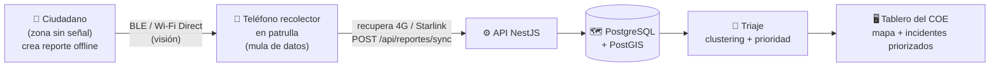
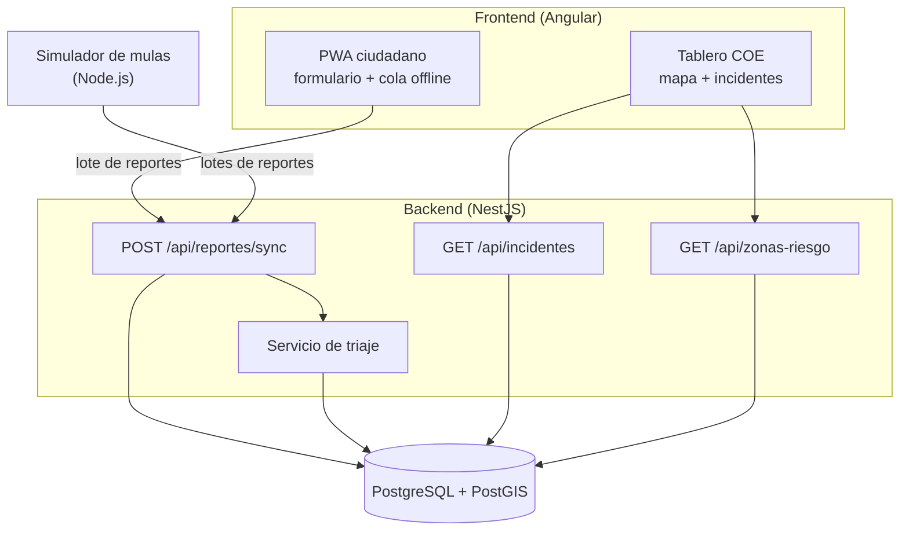

# Sistema de Triaje y Red Resiliente Post-Emergencia

Prototipo del equipo UNIVO para el **Rally Latinoamericano de Innovación 2026 — Desafío 09: Optimización y priorización de recursos y esfuerzos en la post-emergencia**.

> **Estado:** documentación inicial. Todavía no hay código en este repositorio. Este README explica el problema, la solución, cómo se reparte el trabajo y qué falta decidir, para que cualquier integrante del equipo pueda empezar sin haber estado en todas las conversaciones.

---

## Índice

1. [El problema](#1-el-problema)
2. [La solución en una imagen](#2-la-solución-en-una-imagen)
3. [Qué se construye para el rally (MVP) y qué es solo visión](#3-qué-se-construye-para-el-rally-mvp-y-qué-es-solo-visión)
4. [Arquitectura del MVP](#4-arquitectura-del-mvp)
5. [Cómo funciona el triaje](#5-cómo-funciona-el-triaje)
6. [Stack tecnológico](#6-stack-tecnológico)
7. [Estructura propuesta del repositorio](#7-estructura-propuesta-del-repositorio)
8. [Reparto del trabajo](#8-reparto-del-trabajo)
9. [Contrato de la API](#9-contrato-de-la-api)
10. [Guion de la demo](#10-guion-de-la-demo)
11. [Preguntas abiertas](#11-preguntas-abiertas)
12. [Glosario](#12-glosario)

---

## 1. El problema

Después de un terremoto, deslave o inundación severa en El Salvador pasan tres cosas que hacen colapsar la respuesta oficial:

| Problema | Qué pasa |
|---|---|
| **Aislamiento digital y físico** | Caen las torres celulares y la fibra; las rutas quedan bloqueadas. La información no sale de la "Zona Cero". |
| **Caos logístico (fatiga de alarmas)** | Cuando vuelve la señal, muchas personas reportan **el mismo** incidente. Se mandan varias unidades al mismo lugar y otros sectores quedan sin atender. |
| **Decisiones a ciegas** | Con información fragmentada, el COE (Centro de Operaciones de Emergencia) no sabe a quién atender primero ni qué recursos asignar. |

## 2. La solución en una imagen

Una plataforma de software, sin hardware especial, en dos fases:

- **Fase A — Mulas de datos:** los vehículos que entran y salen de la zona (patrullas, ambulancias, vehículos de alcaldía) llevan un teléfono en *Modo Recolector* que recoge los reportes de los ciudadanos al pasar cerca, y los sube al servidor cuando recupera conexión.
- **Fase B — Cerebro de triaje:** el servidor agrupa los reportes duplicados en un solo **Incidente Maestro**, lo prioriza según gravedad y zona de riesgo, y lo muestra al despachador del COE.



## 3. Qué se construye para el rally (MVP) y qué es solo visión

Tenemos ~16 horas, así que **no** se construye todo. Esta tabla es la referencia para no perder tiempo:

| Parte | En el MVP | Cómo se demuestra |
|---|---|---|
| App del ciudadano (crear reporte, guardar offline) | ✅ Sí | **PWA en Angular**, guarda en `IndexedDB`/`localStorage` y sincroniza cuando hay conexión |
| Transferencia teléfono → teléfono por BLE / Wi-Fi Direct | ❌ No (visión) | Se **simula** con el simulador de mulas. Desde un navegador no se puede emitir BLE |
| Mula de datos que sube reportes en bloque | ✅ Simulado | **Script Node.js** que envía lotes de reportes como si fueran varias patrullas |
| Backend con sincronización por lotes | ✅ Sí | NestJS + Prisma |
| Clustering espacial y priorización | ✅ Sí | PostGIS (`ST_ClusterDBSCAN`, `ST_Intersects`) |
| Tablero del COE (mapa + lista priorizada) | ✅ Sí | Página web con mapa (Leaflet o similar) |
| Mapas reales de susceptibilidad del MARN | ⚠️ Por confirmar | Si no se consiguen a tiempo, se usan **zonas ficticias marcadas como tales** |
| Heartbeat de patrullas | ⚠️ Experimental | Ver [Preguntas abiertas](#11-preguntas-abiertas) |
| App Android nativa | ❌ No | Fuera del MVP |

**Por qué la parte BLE es solo visión:** emitir balizas BLE, escanear en segundo plano y usar Wi-Fi Direct son APIs nativas de Android. Una PWA en el navegador no puede hacerlo (Web Bluetooth no emite anuncios ni escanea en segundo plano, y no existe en Safari de iPhone). Para la demo, el simulador representa el viaje del reporte en la patrulla.

## 4. Arquitectura del MVP



**Flujo de un reporte:**

1. El ciudadano llena el formulario en la PWA. El reporte recibe un **UUID generado en el teléfono** y se guarda localmente.
2. Cuando hay conexión (o cuando "pasa la mula", en el simulador), los reportes pendientes se envían en un lote a `POST /api/reportes/sync`.
3. El backend inserta solo los reportes nuevos. Si un UUID ya existe, lo ignora: así, si dos mulas traen el mismo reporte, no se duplica (**idempotencia**).
4. Se recalcula el triaje: los reportes cercanos se agrupan en incidentes y cada incidente recibe una prioridad.
5. El tablero del COE consulta los incidentes ordenados por prioridad y los pinta en el mapa.

## 5. Cómo funciona el triaje

### 5.1 Agrupación espacial (clustering)

Si 50 vecinos reportan el mismo derrumbe dentro de un radio de ~100 m, el sistema no muestra 50 alertas: las fusiona en **1 Incidente Maestro** usando `ST_ClusterDBSCAN` de PostGIS.

- **`eps`**: distancia máxima entre reportes del mismo grupo. Propuesta: 100 m, configurable.
- **`minpoints`**: mínimo de reportes para formar un grupo. Propuesta: 1, para que un reporte aislado también sea un incidente.
- Para medir en **metros** hay que trabajar en una proyección métrica (o con `geography`), no en grados. Detalle de implementación a cargo del backend.

### 5.2 Priorización

Cada incidente recibe un puntaje de 0 a 100 combinando, con pesos configurables:

- Número de reportes del grupo (más reportes = más confianza).
- Total de heridos.
- Si hay personas atrapadas.
- Tipo de emergencia.
- Si el centro del incidente cae dentro de una **zona de riesgo** (`ST_Intersects`); zona roja suma más que naranja o amarilla.

El backend guarda además el **desglose del puntaje**, para que el tablero pueda explicar *por qué* un incidente está arriba. Esto es importante para la presentación ante el jurado.

### 5.3 Heartbeat de patrullas (experimental)

La propuesta original: cada teléfono recolector hace check-in cada 30 min; si se pierde la señal de varias unidades en el mismo cuadrante, se marca "posible colapso estructural".

**Problema conocido:** las patrullas entran a propósito a zonas **sin señal**, así que no pueden hacer ping. Tal como está escrita, la regla marcaría falsas alertas. Ver [Preguntas abiertas](#11-preguntas-abiertas).

## 6. Stack tecnológico

| Capa | Tecnología | Notas |
|---|---|---|
| Frontend | Angular (PWA) | Service worker para funcionar offline; `IndexedDB` para la cola de reportes |
| Backend | NestJS (TypeScript) | Gestor de paquetes: pnpm |
| ORM | Prisma | Para tablas normales. **Prisma no soporta tipos de PostGIS**: lo geoespacial va en SQL crudo con `$queryRaw` |
| Base de datos | PostgreSQL + PostGIS | Levantada con Docker (`postgis/postgis`) |
| Mapa | Leaflet (u otra librería) | Los tiles de OpenStreetMap necesitan internet; el COE sí tiene conexión |
| Simulador | Node.js | Genera reportes realistas alrededor de San Miguel y los envía en lotes |

## 7. Estructura propuesta del repositorio

Propuesta; se puede ajustar cuando empiece el código:

```
/
├── README.md              ← este archivo
├── docs/
│   ├── API.md             ← contrato de la API (request/response)
│   └── PREGUNTAS_ABIERTAS.md
├── backend/               ← NestJS + Prisma + PostGIS
│   ├── prisma/
│   ├── src/
│   └── docker-compose.yml
├── frontend/              ← Angular (PWA ciudadano + tablero COE)
└── simulator/             ← script Node.js de mulas de datos
```

## 8. Reparto del trabajo

| Área | Responsable | Entregable mínimo |
|---|---|---|
| Backend + base de datos + triaje | Julio | `POST /api/reportes/sync`, `GET /api/incidentes`, `GET /api/zonas-riesgo`, clustering y prioridad funcionando |
| Frontend Angular (PWA + tablero) | _por asignar_ | Formulario offline que sincroniza + mapa con incidentes |
| Simulador de mulas | _por asignar_ | Script que inyecta cientos de reportes en lotes |
| Presentación / pitch | _por asignar_ | Diapositivas + guion de demo |

**Regla para no bloquearnos:** frontend y backend trabajan **contra el contrato de [docs/API.md](docs/API.md)**. El frontend puede usar datos falsos con la misma forma mientras el backend no esté listo. Si alguien necesita cambiar el contrato, lo avisa y actualiza ese archivo en un PR.

## 9. Contrato de la API

Resumen; el detalle completo con ejemplos está en **[docs/API.md](docs/API.md)**.

| Método | Ruta | Para qué |
|---|---|---|
| `POST` | `/api/reportes/sync` | Recibir un lote de reportes (PWA o mula). Idempotente por `id` |
| `GET` | `/api/incidentes` | Incidentes ordenados por prioridad |
| `GET` | `/api/incidentes/:id` | Detalle de un incidente con sus reportes |
| `PATCH` | `/api/incidentes/:id` | Cambiar estado (NUEVO → ASIGNADO → ATENDIDO) |
| `GET` | `/api/zonas-riesgo` | Zonas de riesgo en GeoJSON para el mapa |
| `GET` | `/api/health` | Comprobar que la API y la BD responden |

## 10. Guion de la demo

1. Se muestra el tablero del COE vacío.
2. En un teléfono (o navegador en modo avión) se crean 2–3 reportes con la PWA: quedan guardados offline.
3. Se reactiva la conexión: la PWA sincroniza y aparecen en el mapa.
4. Se ejecuta el simulador: "llegan" 2–3 patrullas con cientos de reportes, muchos duplicados.
5. En el tablero, cientos de puntos se convierten en **unos pocos incidentes priorizados**. Los que caen en zona roja quedan arriba, con el desglose de por qué.
6. Se reenvía el mismo lote para mostrar que **no se duplican** (idempotencia).
7. Cierre: se explica la visión de la Fase A (BLE entre teléfonos) como siguiente paso.

## 11. Preguntas abiertas

Cosas que el equipo **todavía no ha decidido**. Detalle en **[docs/PREGUNTAS_ABIERTAS.md](docs/PREGUNTAS_ABIERTAS.md)**.

- ¿Cómo se redefine el heartbeat para que no marque como colapso a las patrullas que entran a zonas sin señal?
- ¿Conseguimos mapas reales del MARN en GeoJSON/shapefile, o usamos zonas ficticias en la demo?
- ¿Quién hace el tablero del COE y quién el simulador?
- ¿Habrá algún componente de IA? La propuesta escrita no menciona ninguno.
- ¿Cómo respondemos al jurado sobre Nearby Connections (depende de Google Play Services) y el alcance real de BLE entre teléfonos?

## 12. Glosario

| Término | Significado |
|---|---|
| **COE** | Centro de Operaciones de Emergencia |
| **Mula de datos** | Dispositivo que transporta información físicamente entre una zona sin conexión y una con conexión (*store-and-forward*) |
| **Incidente Maestro** | Grupo de reportes cercanos que el sistema trata como un solo incidente |
| **Triaje** | Clasificar y ordenar por prioridad a quién atender primero |
| **Idempotente** | Enviar lo mismo varias veces produce el mismo resultado que enviarlo una vez |
| **PostGIS** | Extensión de PostgreSQL para datos geográficos |
| **PWA** | *Progressive Web App*: app web instalable que puede funcionar offline |
| **BLE** | *Bluetooth Low Energy* |
| **MARN** | Ministerio de Medio Ambiente y Recursos Naturales de El Salvador |
